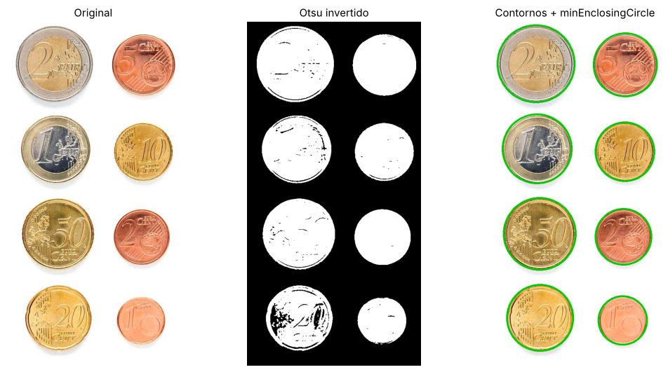
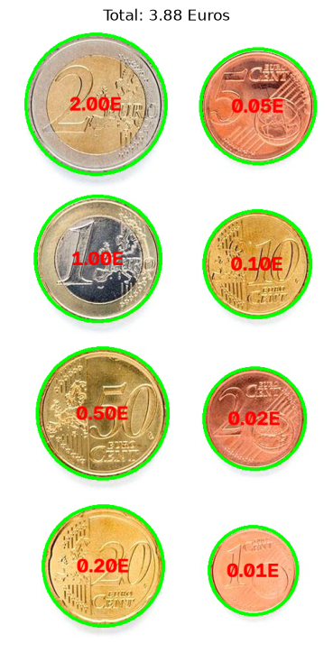
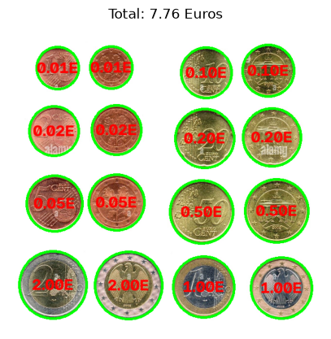
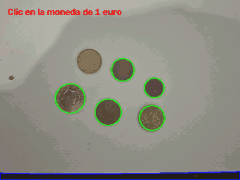
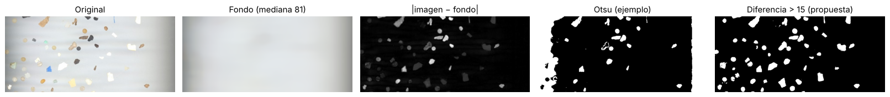
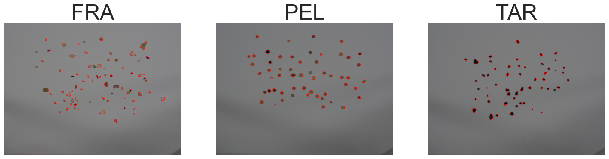
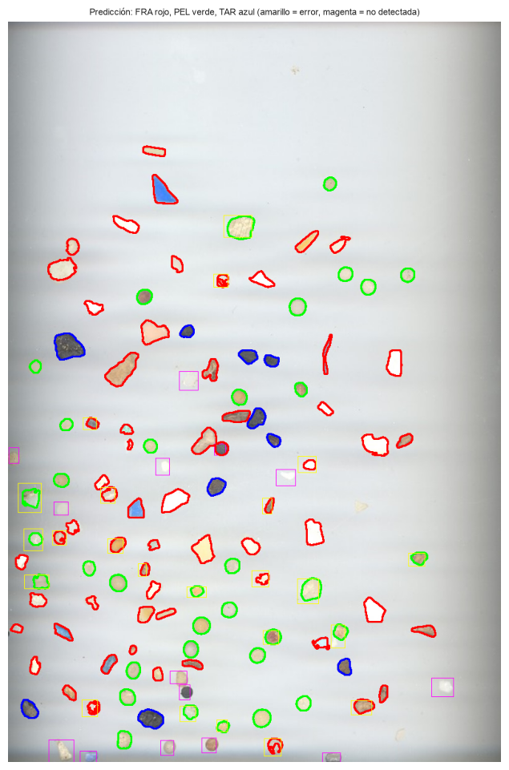
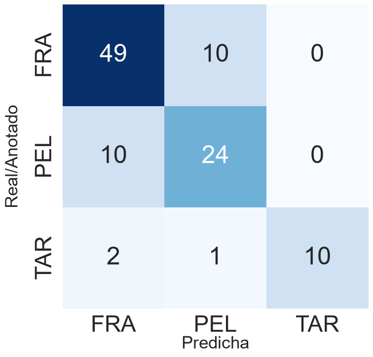

# Práctica 3 – Detección y reconocimiento de formas

**Autor:** Yousef Kassem · [GitHub: @yousef05kassem](https://github.com/yousef05kassem)
**Asignatura:** Visión por Computador · ULPGC · curso 2026/27
**Cuaderno:** [`VC_P3.ipynb`](VC_P3.ipynb)

Esta práctica trata de **detectar objetos por su forma y clasificarlos sin aprendizaje profundo**, solo con umbralizado, contornos y características geométricas y de color. Se resuelven dos problemas:

1. **Contar el dinero** que hay en una imagen de monedas (y en directo con la cámara).
2. **Clasificar microplásticos** en tres clases (fragmentos, pellets y alquitrán) y evaluar el clasificador con una imagen de test anotada.

## Tarea 1: Dinero en la imagen

Umbralizado de Otsu, contornos externos y `minEnclosingCircle` para medir el diámetro de cada moneda. Con un clic en la moneda de 1€ se calcula la relación mm/píxel (23.25 mm / diámetro en píxeles) y cada moneda se asigna al diámetro oficial más cercano. Los objetos no circulares (área / área del círculo < 0.8) no se cuentan.



| Moneda | 1c | 2c | 10c | 5c | 20c | 1 € | 50c | 2 € |
|---|---|---|---|---|---|---|---|---|
| Diámetro (mm) | 16.25 | 18.75 | 19.75 | 21.25 | 22.25 | 23.25 | 24.25 | 25.75 |

Respecto a los ejemplos del cuaderno: umbral de Otsu en lugar de umbral fijo, contornos y `minEnclosingCircle` en lugar de `HoughCircles` (radios más precisos) y relación de áreas en lugar de compacidad para descartar objetos no circulares. Se añade la calibración por clic y la clasificación por el diámetro más cercano.

Resultado: **3.88 €** en la imagen ideal y **7.76 €** en una segunda imagen con 16 monedas, todas correctas.

 

### Demostrador en vivo



El demostrador en vivo usa el mismo procedimiento en cada fotograma. En el GIF se ve con DroidCam (móvil como cámara). Con las monedas quietas el total correcto es **1.30 €**, pero en vivo aparecen estos problemas:

- **Brillos y reflejos:** antes de calibrar, dos monedas salen en azul (no circulares) porque el reflejo rompe su contorno en el umbralizado.
- **El total parpadea:** con pequeños cambios de luz o de posición el resultado salta (1.30 → 1.28 → 2.27 → 0.78 €). Basta con que una moneda se mida 1 mm más grande o más pequeña para que cambie de clase, por ejemplo la de 1 € aparece como 0.50 € o como `?`.
- **Sombras y bordes del papel:** el borde del papel y la sombra de la mano se detectan como contornos (en azul en los bordes); no se cuentan, pero muestran lo sensible que es Otsu al fondo.
- **Mover la cámara** cambia la escala → la calibración deja de valer y hay que volver a hacer clic.
- **Monedas casi iguales** (5c/20c, 2c/10c, 1 €/50c) difieren solo ~1 mm, unos pocos píxeles → se confunden.
- **Monedas solapadas** forman un solo contorno no circular → no se cuentan.

**Mejoras posibles:** usar también el **color** (cobre / dorado / bimetálica) para separar las monedas de tamaño parecido, y suavizar el total en el tiempo (p. ej. la moda de los últimos N fotogramas) para que no parpadee.

## Tarea 2: Clasificación de microplásticos

Segmentación: se estima el fondo con un filtro de mediana grande y se umbraliza la diferencia con la imagen, ya que el umbralizado del ejemplo no detecta los fragmentos claros de la imagen de test.



Las imágenes de entrenamiento se reducen a la mitad para que las partículas tengan un tamaño parecido al de la imagen de test. Partículas extraídas: **74 FRA, 55 PEL, 54 TAR**.



Características (las cinco primeras del artículo SMACC, las dos últimas añadidas):

| Característica | Qué mide | Por qué ayuda |
|---|---|---|
| Compacidad (perímetro² / área) | lo irregular del borde | pellets ≈ círculos, fragmentos con picos |
| Área / área del contenedor | cuánto rellena su caja | formas irregulares rellenan menos |
| Ancho / alto (`minAreaRect`) | alargamiento | fragmentos alargados |
| Eje menor / eje mayor de la elipse | alargamiento | ídem, más robusto al ruido |
| d_min / d_max al contorno | redondez desde el centroide | pellet ≈ 1 |
| Saturación media | color | — |
| Brillo relativo al fondo | oscuro o claro | **alquitrán muy oscuro** |

No se usan área ni perímetro en píxeles porque dependen de la resolución.

Clasificador: distancia al centroide de cada clase con características normalizadas (media 0, desviación 1). Cada anotación del CSV se empareja con la partícula detectada de mayor solape (IoU > 0.4): 106 de 120 emparejadas.

 

*Izquierda:* rojo = FRA, verde = PEL, azul = TAR; amarillo = error; magenta = no detectada. *Derecha:* matriz de confusión (filas = real, columnas = predicha).

| Accuracy | Precision | Recall | F1 |
|---|---|---|---|
| 0.78 | 0.79 | 0.78 | 0.78 |

| Clase | Correctas | Precision | Recall |
|---|---|---|---|
| FRA | 49 / 59 | 0.80 | 0.83 |
| PEL | 24 / 34 | 0.69 | 0.71 |
| TAR | 10 / 13 | 1.00 | 0.77 |

### Análisis
- **TAR** casi nunca se confunde: su color oscuro lo separa claramente (precision 1.0).
- La mayor confusión es **FRA ↔ PEL** (10 en cada dirección): los fragmentos pequeños y redondeados tienen una forma muy parecida a la de un pellet.
- Las **14 no detectadas** son sobre todo partículas muy claras que apenas se diferencian del papel.
- **Mejoras posibles:** k-NN en lugar del centroide, características con menos solape entre FRA y PEL, o una segmentación más fina para los fragmentos claros.

## Cómo ejecutar

```bash
pip install opencv-python numpy matplotlib scikit-learn seaborn
```

La tarea 1 abre una ventana: clic en la moneda de 1 €. El demostrador usa `cv2.VideoCapture(1)` (DroidCam); cambiar a `0` para la webcam integrada.
