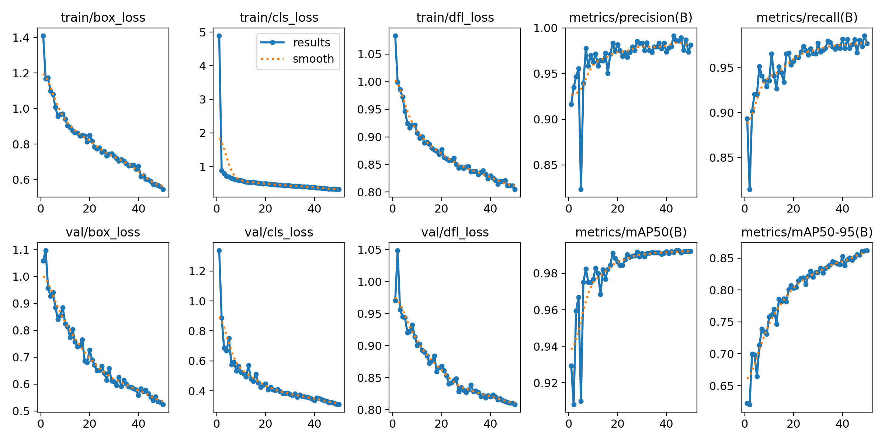
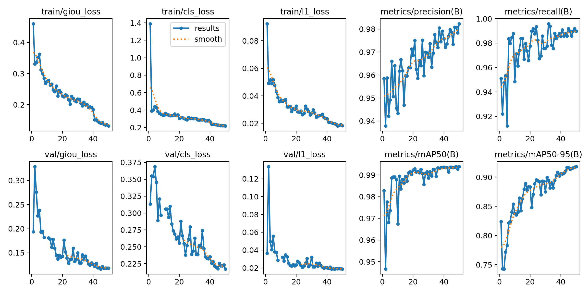
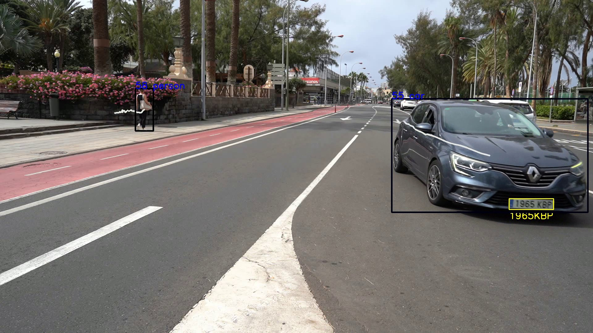
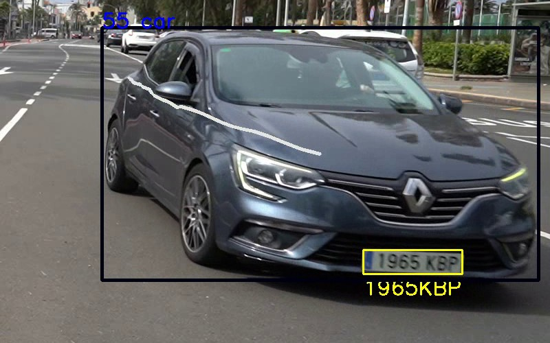
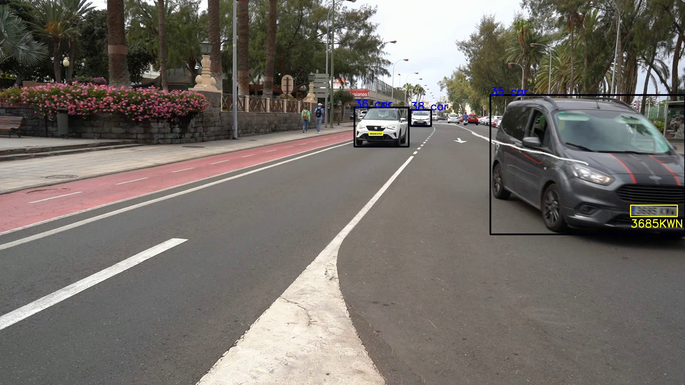
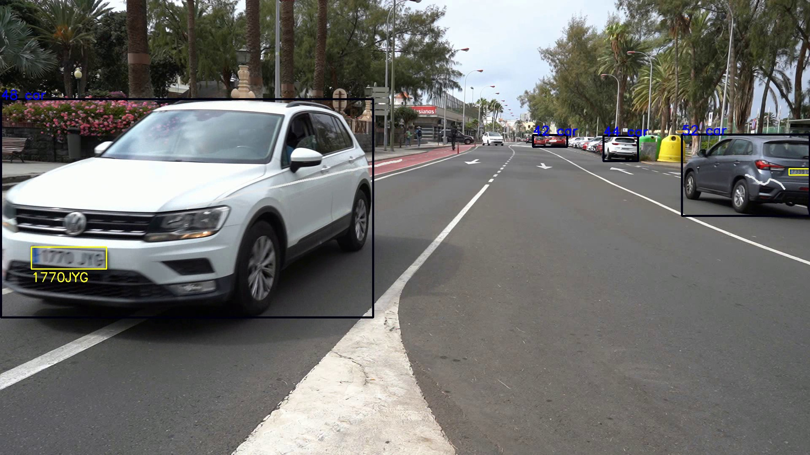
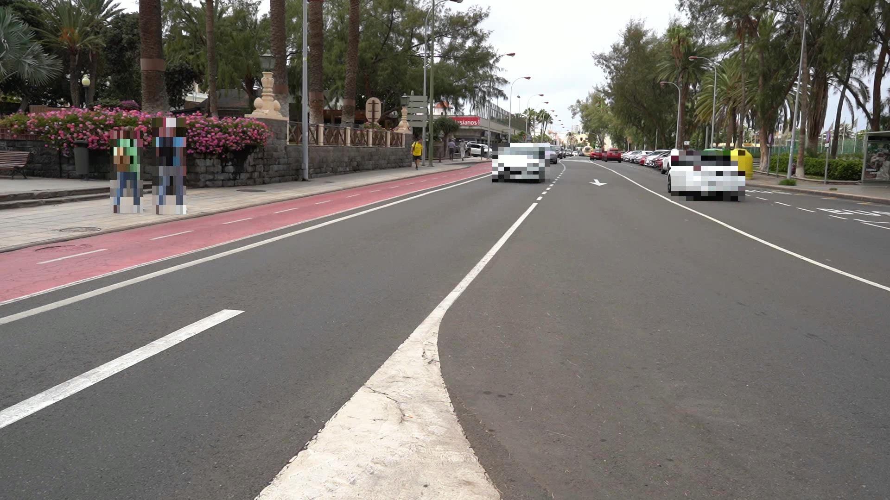
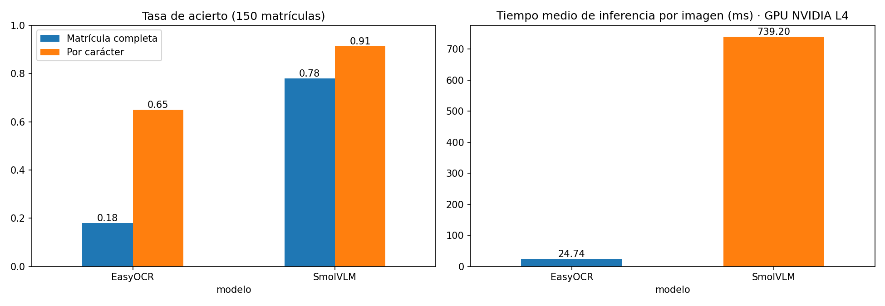

# Práctica 4 y 4b · Detección de vehículos, personas y matrículas + OCR

**Autor:** Yousef Ahmed Kassem · [GitHub: @yousef05kassem](https://github.com/yousef05kassem)

**Asignatura:** Visión por Computador · ULPGC · curso 2026/27

## Índice

1. [Contenido de la carpeta](#contenido-de-la-carpeta)
2. [Detección y seguimiento de personas y vehículos](#1-detección-y-seguimiento-de-personas-y-vehículos)
3. [Conjunto de datos de matrículas](#2-conjunto-de-datos-de-matrículas)
4. [Entrenamiento del detector de matrículas (YOLO11n)](#3-entrenamiento-del-detector-de-matrículas-yolo11n)
5. [Extra: YOLO11n frente a RT-DETR-L](#4-extra-yolo11n-frente-a-rt-detr-l)
6. [Procesamiento del vídeo de test](#5-procesamiento-del-vídeo-de-test)
7. [Extra: flujo por direcciones](#6-extra-flujo-por-direcciones)
8. [Extra: anonimización](#7-extra-anonimización)
9. [P4b · Comparativa OCR: EasyOCR frente a SmolVLM](#8-p4b--comparativa-ocr-easyocr-frente-a-smolvlm)
10. [Extras realizados](#extras-realizados)
11. [Referencias](#referencias)

---

## Contenido de la carpeta

| Archivo | Descripción |
|---|---|
| [`P4_final.ipynb`](P4_final.ipynb) | Procesamiento del vídeo de test: seguimiento, matrículas, OCR con SmolVLM, conteo, CSV, direcciones y anonimización. Ejecutado en Google Colab (GPU NVIDIA L4). |
| [`P4_colab_entrenamiento_y_ocr.ipynb`](P4_colab_entrenamiento_y_ocr.ipynb) | Descarga y conversión del conjunto de datos, entrenamiento de YOLO11n y RT-DETR-L, y comparativa OCR (P4b). Ejecutado en Google Colab (GPU NVIDIA L4). |
| [`matriculas_yolo11n.pt`](matriculas_yolo11n.pt) | Detector de matrículas entrenado (YOLO11n). |
| [`resultados.csv`](resultados.csv) | Resultado del vídeo de test, una fila por objeto y fotograma (separador `;`). |
| `img/` | Gráficas y capturas usadas en este README. |

**Vídeos** (demasiado grandes para GitHub, más de 100 MB):

- 🎥 Vídeo de resultados: **[resultado.mp4](https://drive.google.com/file/d/1j_xClPceNYCxyEPqw85yxt2HrYv0VcNh/view?usp=sharing)**
- 🎥 Vídeo anonimizado: **[resultado_anonimizado.mp4](https://drive.google.com/file/d/1Rts9uYg_4hEtPVB3LzgfErSc9o9xE5Ca/view?usp=sharing)**

En el código se indica con comentarios qué parte viene de la **PLANTILLA del profesor**, qué se ha **MODIFICADO** y qué es **NUEVO**.

---

## 1. Detección y seguimiento de personas y vehículos

Se parte de la celda *Seguimiento* del cuaderno `VC_P4.ipynb` de la asignatura, que usa YOLO11n preentrenado en COCO con `model.track(..., persist=True)` (tracker BoT-SORT). Cada objeto recibe un identificador que se mantiene entre fotogramas.

Cambios respecto a la plantilla:

- Lectura del vídeo de test `C0142.MP4` (1920×1080, 25 fps, 2.832 fotogramas, 113 s) en lugar de la webcam.
- Clases ampliadas a persona, bicicleta, coche, moto, autobús y camión (`classes=[0,1,2,3,5,7]`).
- `model.names[cls]` en lugar de la lista `classNames`, que solo tenía tres clases y fallaba con autobús o camión.
- Parada al final del vídeo. En la versión final (Colab) no hay ventana de visualización; se muestra el progreso cada 250 fotogramas.
- **Conteo:** para cada clase se guarda un conjunto (`set`) con los identificadores de seguimiento; el número de elementos es el número de objetos distintos.
- **Vídeo de resultados** con `cv2.VideoWriter` (mismo tamaño y fps que el original).
- **CSV** con las columnas del enunciado. Como `confianza` aparecía dos veces, la de la matrícula se llama `confianza_matricula`:

```
fotograma;tipo_objeto;confianza;identificador_tracking;x1;y1;x2;y2;matrícula_en_su_caso;confianza_matricula;mx1;my1;mx2;my2;texto_matricula
```

---

## 2. Conjunto de datos de matrículas

Se ha usado **UC3M-LP** (Universidad Carlos III de Madrid), el mayor conjunto abierto de matrículas **españolas**: 1.975 imágenes y 2.547 matrículas, de día y de noche, en calles y aparcamientos.

- Descarga: [Zenodo 17152029](https://zenodo.org/records/17152029) (4,5 GB, licencia CC BY 4.0)
- Repositorio: [github.com/ramajoballester/uc3m-lp](https://github.com/ramajoballester/uc3m-lp)
- Á. Ramajo-Ballester, J. M. Armingol, A. de la Escalera, *Dual license plate recognition and visual features encoding for vehicle identification*, Robotics and Autonomous Systems, 2024.

Se descartaron otros conjuntos de Roboflow porque solo contenían primeros planos de la matrícula (y además turcas), mientras que en el vídeo hay que localizar matrículas pequeñas dentro del coche.

**Conversión a YOLO:** se usó sin cambios el script `labels2yolo.py` de los autores, que convierte el polígono de cada matrícula en una caja YOLO (una sola clase, `matricula`) y reescala las imágenes a 1280 px en el lado mayor. Se mantiene la partición oficial: **1.580 imágenes de entrenamiento** y las **395 de test como validación** (491 matrículas). El archivo `yaml` sigue la plantilla del enunciado.

---

## 3. Entrenamiento del detector de matrículas (YOLO11n)

Entrenamiento en Google Colab con GPU NVIDIA L4, partiendo de `yolo11n.pt` (COCO). Comando de la plantilla del enunciado con estos cambios:

| Parámetro | Plantilla | Usado | Motivo |
|---|---|---|---|
| `device` | `CPU` | `0` | GPU de Colab |
| `imgsz` | 416 | 640 | las matrículas son pequeñas |
| `batch` | 4 | 16 | la GPU permite lotes mayores |
| `epochs` | 40 | 50 | |

```
yolo detect train model=yolo11n.pt data=matriculas.yaml imgsz=640 batch=16 device=0 epochs=50
```

Tiempo de entrenamiento: **0,144 h (≈ 9 minutos)**.

**Resultados en validación (395 imágenes, 491 matrículas):**

| Precision | Recall | mAP50 | mAP50-95 | Inferencia |
|---|---|---|---|---|
| 0,982 | 0,977 | 0,992 | 0,862 | 1,4 ms/imagen (GPU) |



**Análisis:**

- Las tres pérdidas (`box_loss`, `cls_loss`, `dfl_loss`) disminuyen de forma continua tanto en entrenamiento como en validación, por lo que **no hay sobreajuste**.
- Las primeras ~5 épocas son inestables (caída puntual de precision, recall y mAP), algo normal en la fase de calentamiento.
- El mAP50 se estabiliza en torno a 0,99 a partir de la época 25.
- El descenso brusco de las pérdidas de entrenamiento en la época 40 se debe a que Ultralytics desactiva el aumento de datos *mosaic* en las 10 últimas épocas.
- El mAP50-95 y las pérdidas de validación siguen mejorando al final, por lo que con más épocas la localización de las cajas podría mejorar algo.

---

## 4. Extra: YOLO11n frente a RT-DETR-L

RT-DETR es un detector basado en *Transformers*. El cuaderno `VC_P4_RTDETR.ipynb` de la asignatura muestra cómo usar un modelo ya entrenado; para entrenarlo con matrículas se ha usado la **implementación de RT-DETR incluida en Ultralytics**, con el mismo conjunto de datos, `imgsz=640`, 50 épocas y la misma GPU. Solo cambia el `batch` (8), porque RT-DETR necesita más memoria.

| | **YOLO11n** | **RT-DETR-L** |
|---|---|---|
| Precision | 0,982 | 0,984 |
| Recall | 0,977 | **0,992** |
| mAP50 | 0,992 | 0,994 |
| mAP50-95 | 0,862 | **0,916** |
| Inferencia (GPU L4) | **1,4 ms/imagen** | 7,6 ms/imagen |
| Parámetros | **2,6 M** | 32,0 M |
| Tamaño del modelo | **5,5 MB** | 66,2 MB |
| Tiempo de entrenamiento | **0,14 h** | 1,0 h |



En RT-DETR las pérdidas son distintas (`giou_loss`, `cls_loss`, `l1_loss`). Todas disminuyen en entrenamiento y validación, así que tampoco hay sobreajuste. Las primeras épocas son más inestables que en YOLO, algo habitual en modelos basados en *Transformers*, y también se ve el salto de la época 40 al desactivar *mosaic*.

**Conclusión:** RT-DETR-L encuentra algo más de matrículas (recall 0,992 frente a 0,977) y las localiza con más precisión (mAP50-95 0,916 frente a 0,862). Sin embargo, YOLO11n es unas 5 veces más rápido, 12 veces más pequeño y se entrena 7 veces más rápido, con un mAP50 prácticamente igual. Por eso para el vídeo se usa **YOLO11n**. Hay que tener en cuenta que se compara el modelo más pequeño de YOLO con un modelo grande de RT-DETR (Ultralytics no ofrece una versión más pequeña), así que parte de la diferencia se debe al tamaño del modelo.

---

## 5. Procesamiento del vídeo de test

Cuaderno: [`P4_final.ipynb`](P4_final.ipynb). Para cada fotograma:

1. **Seguimiento** de personas y vehículos con YOLO11n.
2. **Matrícula:** el detector entrenado se aplica sobre el **recorte de cada vehículo** (coche, moto, autobús o camión), donde la matrícula se ve más grande que en el fotograma completo. Solo en vehículos de al menos 120×80 px y con `imgsz=320`, porque el recorte es pequeño. Las coordenadas se pasan después al fotograma completo.
3. **OCR (P4b):** con SmolVLM (ver la [elección del OCR](#elección-del-ocr-para-el-vídeo)). Cada vehículo se lee como mucho cada 5 fotogramas y solo si la matrícula mide al menos 60 px de ancho; se descartan lecturas de menos de 4 o más de 8 caracteres. Todas las lecturas se guardan por identificador y se muestra la **más votada** (cada lectura cuenta 1, SmolVLM no devuelve confianza), para compensar errores puntuales. En total se hicieron 105 lecturas con SmolVLM.
4. Se dibuja todo en el vídeo y se escribe una fila por objeto en el CSV.









### Conteo de objetos (vídeo completo)

| Clase | Objetos distintos |
|---|---|
| persona | 16 |
| coche | 43 |
| autobús | 2 |
| camión | 2 |
| moto | 2 |
| bicicleta | 1 |

### Matrículas leídas

Se obtuvo lectura en **26 vehículos**. En negrita, las que tienen el formato completo de una matrícula española (4 dígitos + 3 consonantes):

| ID | Lectura | ID | Lectura | ID | Lectura |
|---|---|---|---|---|---|
| 1 | 322555 | 18 | **2314FGN** | 41 | S695LTR |
| 8 | 1234 | 21 | 5726 | 48 | **1770JYG** |
| 9 | **3713LKC** | 23 | **0053JFW** | 52 | 7339LG5 |
| 10 | 515957 | 24 | 2537 | 53 | B098JXM |
| 11 | KFST | 26 | 0285FZ | 55 | **1965KBP** |
| 12 | **0848MCG** | 32 | **3902FXD** | 56 | 3S270 |
| 13 | 5555 | 35 | **3685KWN** | 57 | S163LCV |
| 15 | 6713HG3 | 36 | **9059LVY** | 60 | 1933 |
| | | 38 | 8S36LKJ | 63 | S017H30 |

- **9 lecturas** tienen formato válido. En las capturas se puede comprobar que `1965KBP` y `1770JYG` coinciden con la matrícula real; un formato válido no garantiza que la lectura sea correcta.
- Otras 4 serían válidas salvo por confundir **S con 5** o **B con 8** en la parte numérica (`8S36LKJ`, `S695LTR`, `S163LCV`, `B098JXM`).
- Con matrículas muy pequeñas o borrosas SmolVLM a veces **inventa** un texto (`1234`, `5555`), un problema típico de los VLM.

Como comparación, en una primera versión ejecutada en el portátil con **EasyOCR** solo se obtuvo lectura en 11 vehículos y únicamente `1965KBP` tenía el formato completo.

### Limitaciones

- Las matrículas del vídeo son **pequeñas, inclinadas y con desenfoque de movimiento**, por lo que incluso SmolVLM falla en muchas lecturas.
- Una mejora sencilla sería corregir por posición (en los cuatro primeros caracteres solo puede haber dígitos: S → 5, B → 8, O → 0…).
- El conteo se basa en identificadores: si el tracker pierde un objeto (por ejemplo, tras una oclusión) le asigna un identificador nuevo y se **cuenta dos veces**.
- La clase de un mismo identificador puede cambiar entre fotogramas (por ejemplo, autobús ↔ coche). El ID 35 aparece como moto en la lista final aunque en el vídeo es una furgoneta detectada como coche (segunda imagen).

---

## 6. Extra: flujo por direcciones

Para cada identificador se guarda la posición del centro de la caja en cada fotograma (idea del `track_history` del bloque `if 0` de la plantilla, que también se usa para dibujar la trayectoria de las últimas 30 posiciones). Al final se compara la primera y la última posición: el desplazamiento dominante (horizontal o vertical) da la dirección; si el objeto se ha movido menos del 5 % del ancho de la imagen se considera *parado*.

| Clase | Izquierda | Derecha | Parado |
|---|---|---|---|
| coche | 25 | 5 | 12 |
| persona | 3 | 10 | 1 |
| moto | 1 | 1 | 0 |
| bicicleta | 1 | 0 | 0 |

No aparece ningún movimiento hacia arriba o abajo. Autobús y camión no aparecen en esta tabla: para la dirección se usa la última clase detectada de cada identificador, y probablemente YOLO terminó clasificando esos vehículos como *coche* (ver [limitaciones](#limitaciones)).

---

## 7. Extra: anonimización

En una copia limpia de cada fotograma se **pixelan todas las personas y vehículos detectados**: la región se reduce a 10×10 píxeles y se vuelve a ampliar con `INTER_NEAREST`. El resultado se guarda en un segundo vídeo, `resultado_anonimizado.mp4`, y el vídeo principal se mantiene sin pixelar para poder ver las matrículas leídas.



Solo se anonimiza lo que detecta YOLO: las personas lejanas o pequeñas que no se detectan (por ejemplo, la persona de amarillo en el fondo) quedan sin pixelar.

---

## 8. P4b · Comparativa OCR: EasyOCR frente a SmolVLM

Cuaderno: [`P4_colab_entrenamiento_y_ocr.ipynb`](P4_colab_entrenamiento_y_ocr.ipynb), sección 6.

**Modelos** (a partir de los ejemplos de `VC_P4b.ipynb`):

- **EasyOCR** (OCR clásico, red neuronal especializada) con `allowlist` de dígitos y mayúsculas.
- **SmolVLM-Instruct** (VLM) con el *prompt* del ejemplo más *"Answer only with the characters."*. En GPU se usa `_attn_implementation="eager"` porque `flash_attention_2` no está instalado en Colab.

**Condiciones del experimento:**

- **150 matrículas** de tipo A (turismos) elegidas al azar (`random.seed(0)`) de la partición de test de UC3M-LP; 16 de ellas son de noche.
- Por privacidad, el conjunto de datos tapa con un recuadro gris dos de los siete caracteres de cada matrícula. Como referencia se usan los **cinco caracteres visibles** (p. ej. `24*0JV*` → `240JV`).
- Misma máquina, mismas imágenes y mismo post-procesado para ambos (mayúsculas, solo letras y dígitos, sin la `E` de la franja de la UE).
- Tiempo medido por imagen, tras una llamada de calentamiento y sin contar la carga del modelo.

**Métricas:** *acierto exacto* (matrícula completa correcta) y *acierto por carácter* = 1 − CER (distancia de Levenshtein / longitud de la referencia).

**Máquina:** Google Colab, GPU NVIDIA L4 (22,5 GB), CPU Intel Xeon @ 2,20 GHz, 52 GB de RAM.

| | **EasyOCR** | **SmolVLM** |
|---|---|---|
| Acierto exacto | 18 % | **78 %** |
| Acierto por carácter | 65 % | **91 %** |
| Acierto exacto de día | 17,9 % | **79,9 %** |
| Acierto exacto de noche (16 imágenes) | 18,8 % | **62,5 %** |
| Tiempo medio por imagen | **24,7 ms** | 739,2 ms |



**Conclusiones:**

- SmolVLM es claramente más preciso: lee completa el 78 % de las matrículas y el 91 % de los caracteres, frente al 18 % y el 65 % de EasyOCR.
- EasyOCR es unas **30 veces más rápido** (24,7 ms frente a 739,2 ms por imagen), lo que lo hace utilizable en tiempo real.
- Parte de los errores de EasyOCR se deben a que **interpreta los recuadros grises de anonimización como caracteres** (p. ej. `8811PZ` en lugar de `891RZ`), mientras que SmolVLM los ignora. Por tanto, esta comparativa favorece al VLM; con matrículas sin tapar la diferencia probablemente sería menor.
- De noche SmolVLM empeora (62,5 %), aunque con solo 16 imágenes nocturnas el resultado es poco representativo.
- Las matrículas muy sobreexpuestas o borrosas fallan con ambos modelos.

Es el compromiso descrito en el enunciado: la red especializada es rápida y el VLM consigue mayor tasa de acierto con mucho más coste computacional.

### Elección del OCR para el vídeo

En una primera versión el vídeo se procesó en un portátil **sin GPU** con **EasyOCR**, porque SmolVLM tardaría varios segundos por matrícula. El resultado fue pobre: lectura en 11 vehículos y solo una matrícula completa.

A la vista de la comparativa, la versión final se ejecutó en **Google Colab con GPU (NVIDIA L4)** usando **SmolVLM**: procesar el vídeo completo (2.832 fotogramas, 105 lecturas OCR) tardó solo unos minutos y se obtuvo lectura en 26 vehículos, 9 de ellas con formato completo. Para compensar errores puntuales se combinan varias lecturas por vehículo mediante votación.

---

## Extras realizados

- [x] Flujo de personas y vehículos por direcciones (+0,25)
- [x] Dos alternativas para la detección de matrículas: YOLO y RT-DETR (+1)
- [ ] Detección de matrículas basada en contornos
- [x] Anonimización de personas y vehículos (+0,25)

---

## Referencias

- Enunciado y cuadernos de la asignatura: [otsedom.github.io/VC](https://github.com/otsedom/otsedom.github.io/tree/main/VC)
- Ultralytics YOLO11 y RT-DETR: [docs.ultralytics.com](https://docs.ultralytics.com)
- Zhao et al., *DETRs Beat YOLOs on Real-time Object Detection* (RT-DETR), 2023. [arXiv:2304.08069](https://arxiv.org/abs/2304.08069)
- UC3M-LP: [github.com/ramajoballester/uc3m-lp](https://github.com/ramajoballester/uc3m-lp) · [Zenodo](https://zenodo.org/records/17152029)
- EasyOCR: [github.com/JaidedAI/EasyOCR](https://github.com/JaidedAI/EasyOCR)
- SmolVLM: [huggingface.co/blog/smolvlm](https://huggingface.co/blog/smolvlm)
